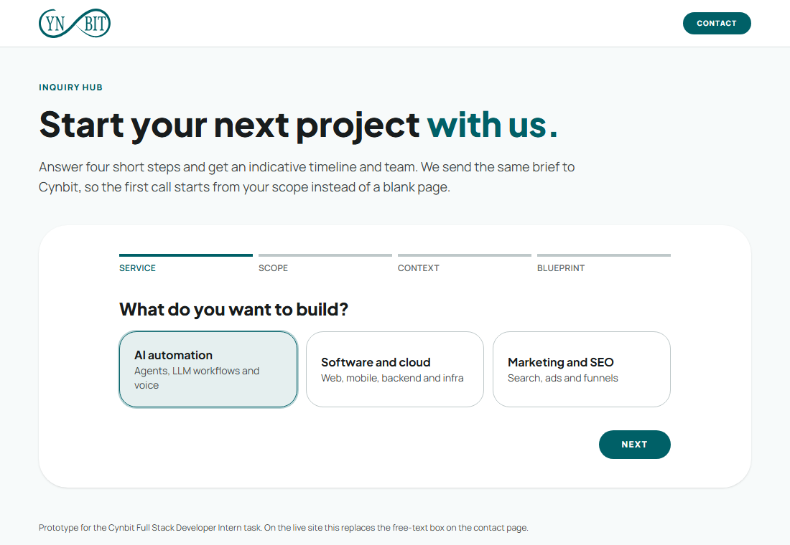
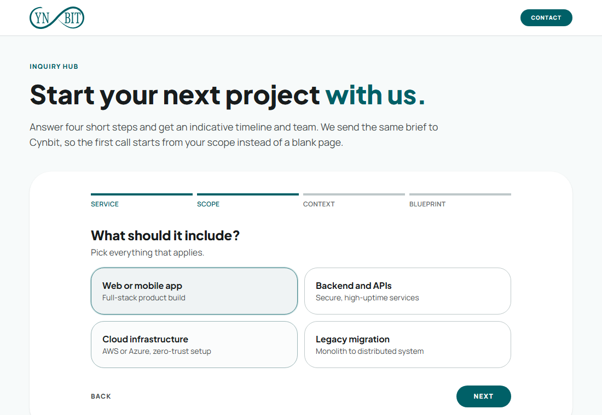
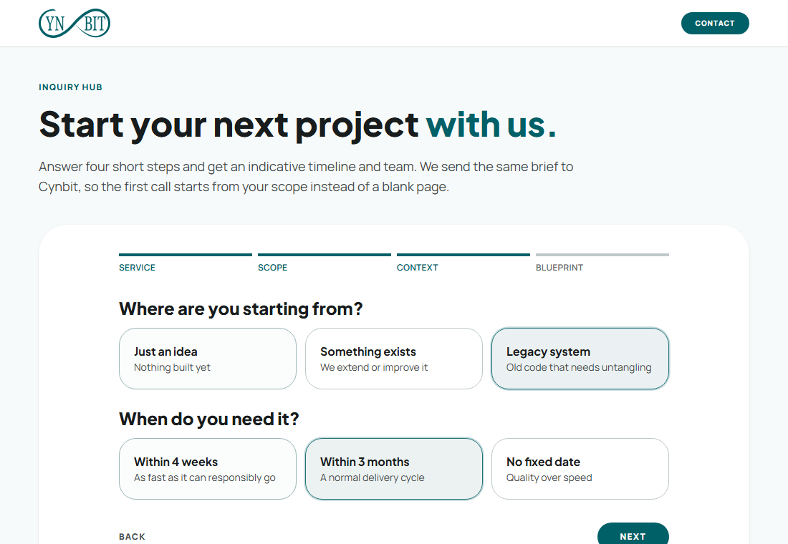
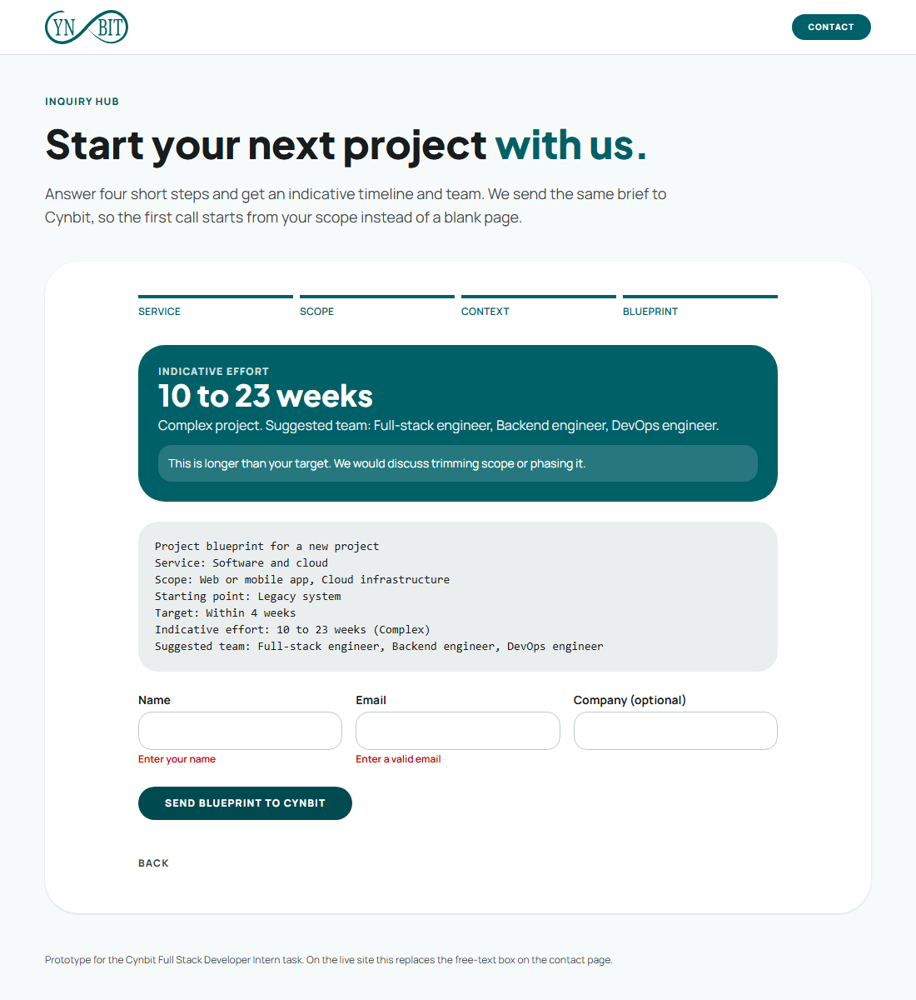
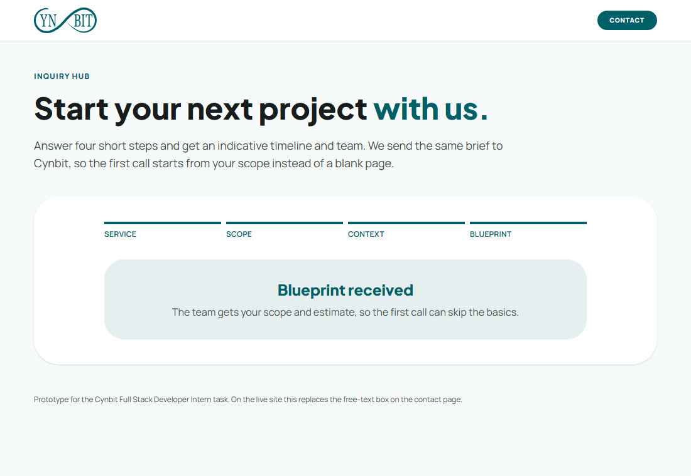
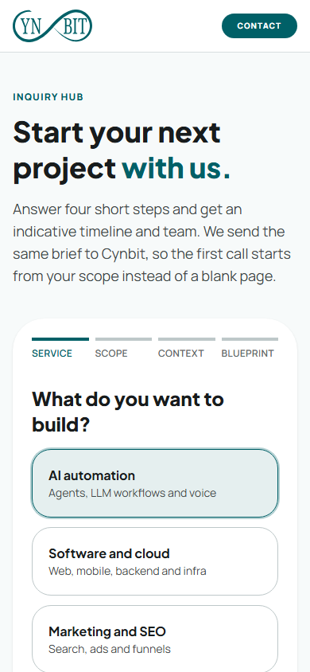

# Technical Report: Cynbit Project Blueprint

Candidate: Tanishq Jain. Task: improve cynbit.in with a working prototype.

Live demo: https://cynbit-blueprint.vercel.app

Repository: https://github.com/iamtanishqjain/cynbit-project-blueprint

## 1. What I looked at

I went through the home, services and contact pages as a visitor, then measured them as a developer.

**How I measured.** Lighthouse 12.8.2, mobile emulation with its default simulated throttling, in headless Chrome 156. I ran the contact page and my own page three times each, because single runs vary. I did not submit Cynbit's real contact form, to avoid sending the team a fake inquiry. I read its fields and markup instead.

**What I found on cynbit.in (mobile):**

| Page | Performance | Accessibility | LCP | Total blocking time |
| --- | --- | --- | --- | --- |
| Home | 52 | 82 | 11.5 s | 840 ms |
| Services | 58 | 90 | 11.1 s | 570 ms |
| Contact (3 runs) | 54 to 63 | 90 | 9.9 to 11.1 s | 460 to 740 ms |

- **Slow first paint of text.** The Largest Contentful Paint element is a plain paragraph. On the contact page the server answers in about 0.7 s, then there is roughly 9.6 s of render delay before that paragraph shows. Heavy JavaScript on the main thread is the likely cause, but I did not trace it to one script.
- **Weight and blocking.** About 1.67 MB over 40 to 44 requests. Lighthouse flags render-blocking CSS and the Material Symbols icon font from Google Fonts. Google Tag Manager blocks the main thread for about 320 to 390 ms and ships about 75 to 92 KiB of unused JavaScript.
- **Accessibility.** On the home page a link has a contrast ratio of 4.04, under the 4.5 minimum. Headings skip a level (h2 to h4) on home and contact.
- **What is good.** Best practices score 100, SEO scores 100 on the home and services pages, layout shift is about zero and images have alt text.
- **The contact form.** Four short fields and one free-text box labelled "Your message". The page promises a 24 hour response. Every "Inquire" and "Start discovery" button on the site ends here.
- **Stack.** Next.js (App Router). The markup uses Tailwind utility classes with Material-style tokens such as `bg-surface` and `text-on-surface-variant`. Fonts are Plus Jakarta Sans for headings and Manrope for body text.

## 2. The problem, and why I chose it

The measured weak spot is speed. I did not pick it for the prototype, for a practical reason: fixing it means changing their codebase and tag setup, which I cannot see or deploy. I list the concrete leads in section 7 instead.

What I could build and show end to end is a fix for what the site exists to do, which is turn visitors into inquiries. A visitor who has just read about voice agents or legacy migration lands on a blank message box. The form does not know which service they came for, how big the job is, or when they need it. That has three costs:

- Visitors have to write a good brief from scratch, and many will not.
- Nothing tells them whether the job is days or months, so they cannot tell if Cynbit fits.
- Cynbit's first reply has to be a round of questions (scope, stage, deadline) before a real conversation starts.

## 3. The improvement

A short wizard that does the scoping for the visitor.

1. **Service.** AI automation, software and cloud, or marketing and SEO.
2. **Scope.** Four features per service, taken from the services page (for example agents, LLM automation, voice agents, stack integration).
3. **Context.** Starting point (idea, existing product, legacy system) and target date.
4. **Blueprint.** An indicative effort range, a project tier, a suggested team and a plain-text brief. The visitor adds a name and email and sends it.

The estimate is a heuristic, not a quote. Each feature has a min and max in weeks. The longest feature counts in full and each extra one counts at 70%, because real projects share setup, auth and deployment work. A starting-point factor then scales the total: 0.85 for an existing product, 1.3 for a legacy system. If the minimum is longer than the visitor's target date, the page says so and suggests phasing the work instead of showing a happy number.

The page is laid out like their contact page and uses their design tokens: primary `#006067`, background `#f7fafa`, pill buttons, large rounded cards, Plus Jakarta Sans and Manrope. The logo is Cynbit's own `logo.svg`, used here only for this demo.

## 4. Stack and why

- **Next.js 15, TypeScript, Tailwind.** Cynbit already uses these, so a component or route from this prototype can move into their site without a rewrite.
- **`next/font`.** The two fonts are self-hosted at build time, so there is no extra render-blocking request to Google Fonts.
- **Pure logic in `src/lib/blueprint.ts`.** Catalogue, estimate, brief and validation are plain functions. That keeps the part that can be wrong easy to test without a browser.
- **A route handler for submit.** `/api/inquiry` validates the whole payload again on the server (service, feature ids, stage, timeline, email) instead of trusting the client. It forwards to an optional webhook, or logs, so no database or account is needed to run the demo.
- **Vitest.** Quick, no config, works with TypeScript.

## 5. Results

**Behaviour.** 9 unit tests cover the estimate maths, the tight-timeline flag, validation and the brief text. All pass, along with `eslint`, `tsc` and `next build`. I also drove the production build in a browser. Software and cloud, Web or mobile app plus Cloud infrastructure, Legacy system, Within 4 weeks gave 10 to 23 weeks, a Complex tier and the tight-timeline warning. By hand: (6 + 2 x 0.7) x 1.3 rounds to 10 and (14 + 5 x 0.7) x 1.3 rounds to 23. Empty fields showed both errors, and valid data returned the confirmation.

**Bugs found while testing, and fixed:**
- Quick successive selections were dropped because updates read stale state.
- The brief heading was blank before a name was typed.
- The tab title was still "Create Next App".

**Speed and accessibility, same tool and settings, deployed pages:**

| | Performance | Accessibility | Best practices | SEO | LCP | Total blocking time | Page weight |
| --- | --- | --- | --- | --- | --- | --- | --- |
| cynbit.in/contact (3 runs) | 54 to 63 | 90 | 100 | 92 * | 9.9 to 11.1 s | 460 to 740 ms | about 1.67 MB |
| Blueprint demo (3 runs) | 97 to 100 | 100 | 100 | 100 | 1.2 to 1.9 s | 50 to 190 ms | 177 KiB |

\* The 92 comes from Lighthouse failing to download `robots.txt`. The file does exist and returns 200, so I do not count it as a real SEO problem.

This is not a like-for-like contest. My page is one screen with no analytics or tag manager, and theirs is a full marketing page. It does show what the same tool reports for a page built without the problems in section 1.

I have not measured a conversion change, because that needs real traffic. The measurable version is the share of contact visits that become a submitted inquiry, plus how many first replies no longer need a scoping round.

## 6. Screenshots

| Step | Screenshot |
| --- | --- |
| 1. Pick a service |  |
| 2. Pick the scope |  |
| 3. Starting point and deadline |  |
| 4. Blueprint with the tight-timeline warning and field errors |  |
| 5. After sending |  |
| Phone width |  |

## 7. Limits and next steps

- The week ranges are my own estimates from the services page. Cynbit should replace them with numbers from past projects. They live in one array in `src/lib/blueprint.ts`.
- Submissions are only forwarded or logged. A real version would store them and email the visitor a copy of the brief.
- The wizard is a separate app here. On the real site it belongs on `/contact`, with each "Inquire" button on `/services` opening it with the service already chosen.
- Lighthouse results are lab numbers from one machine with simulated throttling. They show the size of the problem, not exact field timings.
- **Where I would start on their speed problem:** load Google Tag Manager after the page is interactive, self-host or subset the Material Symbols font instead of the render-blocking Google Fonts stylesheet, find what holds the first paragraph back for about 10 s, and fix the contrast and heading-order issues.
- `npm audit` still reports `sharp` and a nested `postcss` inside Next.js. This app does not use `next/image` optimisation, so `sharp` is not exercised. I upgraded Next from 15.5.4 to 15.5.28, which cleared the critical finding. The rest need a major version bump, which I left alone.
- To reproduce the numbers: `npx lighthouse <url> --only-categories=performance,accessibility,best-practices,seo --form-factor=mobile`.
